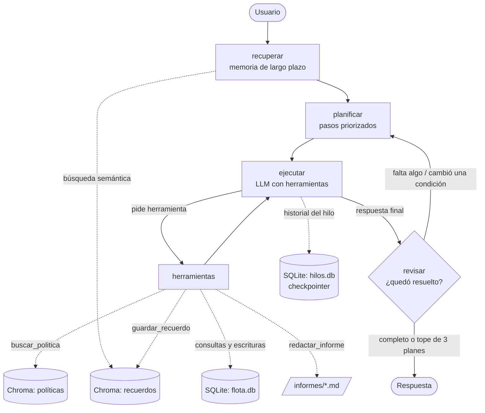

# Agente de gestión de flota — MicroLogist

Evaluación Parcial 2 · ISY0101 Ingeniería de Soluciones con IA

Agente que revisa la flota de una empresa de transporte (datos simulados), detecta documentos vencidos o por
vencer y mantenciones atrasadas, consulta las políticas internas, y actúa: crea órdenes de trabajo, bloquea
vehículos y redacta informes. Planifica las tareas por prioridad y replanifica cuando una condición cambia.

## Requerimiento organizacional

En MicroLogist el control de vencimientos (revisión técnica, permiso de circulación, SOAP) y de mantenciones
se hace revisando ficha por ficha. El agente automatiza ese flujo: **revisar → decidir según política → registrar
la acción → informar**.

## Arquitectura y orquestación



| Nodo ([agente/grafo.py](agente/grafo.py)) | Qué hace |
|---|---|
| `recuperar` | Busca por significado, en la memoria de largo plazo, recuerdos relacionados con el mensaje. |
| `planificar` | El LLM devuelve una lista estructurada de pasos (`Plan`), ordenada por urgencia. |
| `ejecutar` | El LLM sigue el plan y decide qué herramienta llamar (ciclo razonar–actuar). |
| `herramientas` | Ejecuta la herramienta pedida si está autorizada por el plan y devuelve el resultado al LLM. |
| `revisar` | El LLM evalúa (`Revision`) si la solicitud quedó resuelta; si no, vuelve a `planificar`. |

### Herramientas ([agente/herramientas.py](agente/herramientas.py))

| Tipo | Herramienta | Función |
|---|---|---|
| Consulta | `consultar_vehiculo` | Ficha, documentos y órdenes abiertas de una patente. |
| Consulta | `revisar_flota` | Pendientes de toda la flota, ordenados por urgencia. |
| Consulta (semántica) | `buscar_politica` | Recupera las políticas internas relevantes a una pregunta. |
| Escritura | `crear_orden` | Registra una orden; rechaza duplicados y datos inválidos. |
| Escritura | `cambiar_estado` | Cambia el estado del vehículo; no bloquea uno que está en taller. |
| Escritura | `redactar_informe` | Genera un informe Markdown en `datos/informes/`. |
| Escritura | `guardar_recuerdo` | Guarda un hecho en la memoria de largo plazo. |

El razonamiento lo aportan los nodos `planificar`, `ejecutar` y `revisar`.

### Memoria

- **Corto plazo:** el historial de cada conversación se guarda con el *checkpointer* de LangGraph en
  `datos/hilos.db`, por `thread_id`. Al volver a ejecutar `python main.py <hilo>` la conversación continúa.
- **Largo plazo y recuperación semántica:** Chroma persistente en `datos/chroma/`, con embeddings locales.
  La colección `recuerdos` se consulta al inicio de cada turno; la colección `politicas` es la base de conocimiento.

### Planificación y decisiones adaptativas

El plan se genera antes de actuar y se rehace cuando el revisor detecta algo pendiente. Las herramientas
devuelven rechazos explícitos (orden duplicada, vehículo en taller, patente inexistente) y el agente debe
adaptar el resto del plan a esa condición.

**Autorización de escrituras.** El planificador declara qué herramientas de escritura autoriza la solicitud
(una pregunta, ninguna; un informe, solo `redactar_informe`). El nodo `herramientas` rechaza en código cualquier
escritura no autorizada: en las pruebas con el modelo real, la instrucción en el prompt no bastaba y el agente
creaba órdenes ante una simple pregunta.

**Límites del proveedor.** Ante un límite por minuto el agente espera lo que indica el proveedor y reintenta;
ante el límite diario informa el error sin botar la sesión.

## Instalación

Requiere Python 3.12.

```bash
python -m venv .venv
```

```bash
.venv\Scripts\activate
```

```bash
pip install -r requirements.txt
```

Copiar `.env.example` a `.env` y completar `GROQ_API_KEY` (key gratuita en https://console.groq.com/keys). El proveedor se puede cambiar en `LLM_MODELO`.

## Ejecución

```bash
python main.py
```

```bash
python main.py turno-noche
```

El segundo comando usa otro hilo de conversación. La consola muestra cada paso: `[memoria]`, `[plan]`,
`[herramienta]`, `[resultado]`, `[replanificar]`. Para reiniciar los datos simulados, borrar la carpeta `datos/`.

## Escenarios de demostración

| # | Mensaje | Qué se observa |
|---|---|---|
| 1 | `Revisa la flota y regulariza todo lo pendiente` | Plan priorizado: vencidos → por vencer → mantenciones. Bloquea KXTR45 y crea sus órdenes. |
| 2 | (mismo turno) | Condición distinta: HRBD78 también tiene la revisión vencida, pero está en taller y ya tiene orden. El agente no lo bloquea ni duplica la orden. |
| 3 | `Recuerda que el taller no recibe vehículos los sábados` y, en **otro hilo**, `¿Cuándo puedo mandar el PGSY90 al taller?` | Memoria de largo plazo: el recuerdo aparece en `[memoria]` en una conversación nueva. |
| 4 | `¿Y qué pasó con el primero que bloqueaste?` | Memoria de corto plazo: resuelve la referencia con el historial del hilo. |
| 5 | `Genera un informe del estado de la flota` | Escritura: archivo en `datos/informes/`. |
| 6 | `Bloquea el vehículo ABCD12` | Patente inexistente: la herramienta rechaza y el agente lo informa sin inventar datos. |

## Pruebas

```bash
python -m pytest -q
```

[tests/test_agente.py](tests/test_agente.py) cubre: consulta ordenada por urgencia, validaciones de escritura,
recuperación semántica, el grafo completo (replanificación y continuidad del hilo) y el rechazo de escrituras
no autorizadas, con un LLM guionado, sin API key.

## Estructura

```
agente/datos.py         base SQLite simulada
agente/memoria.py       memoria de largo plazo y políticas (Chroma)
agente/herramientas.py  herramientas de consulta y escritura
agente/grafo.py         orquestación (LangGraph)
main.py                 chat por consola
tests/                  pruebas
```

## Decisiones de diseño

- **LangGraph y no un agente ReAct de bucle único:** el flujo queda declarado como grafo explícito (planificar,
  ejecutar, revisar y replanificar si falta algo). Trae el checkpointer para la memoria de corto plazo y permite
  reemplazar nodos estándar por propios, como el de herramientas que valida permisos. Con `init_chat_model` el
  proveedor del modelo se cambia por configuración.
- **Planificador, ejecutor y revisor separados:** cada rol tiene una salida acotada. El plan estructurado define la
  prioridad y los permisos de escritura antes de tocar datos, y el razonamiento queda visible en la consola.
- **SQLite para el historial y Chroma para lo semántico:** el historial necesita orden exacto y persistencia, no
  búsqueda por significado; SQLite lo entrega sin servidor. Recuerdos y políticas se consultan por significado,
  porque el usuario no repite las mismas palabras; Chroma funciona en local, persistente y sin clave de API.
- **Reglas críticas en código y no solo en el prompt:** el modelo es probabilístico. En las pruebas creó órdenes y
  bloqueó vehículos ante una pregunta y ante un pedido de informe, pese a la instrucción en contra. Lo que modifica
  la flota se valida en código, donde es determinista y verificable con pruebas.
- **Tope de 3 planes:** acota el consumo de tokens y evita un bucle infinito entre planificar y revisar. En las
  ejecuciones nunca se necesitaron más de 2.
- **Groq con `openai/gpt-oss-120b`:** la capa gratuita de Gemini no estaba disponible para la cuenta; Groq es
  gratuito y de baja latencia, útil para una demo en vivo. El modelo soporta herramientas y salida estructurada; el
  de 20B siguió peor el plan. El costo son los límites de uso.

## Limitaciones conocidas

- El historial de un hilo no se resume ni recorta; un hilo muy largo puede exceder la ventana del modelo.
- Los embeddings por defecto de Chroma están entrenados principalmente en inglés.
- Datos y políticas son simulados; no hay conexión con el sistema real de MicroLogist.
- La capa gratuita de Groq limita `openai/gpt-oss-120b` a 200.000 tokens por día; el escenario 1 completo consume una parte importante. Para la demo conviene llegar con la cuota del día sin usar.
- Los modelos pequeños (p. ej. `openai/gpt-oss-20b`) siguen peor el plan y pueden ejecutar acciones no pedidas.

## Uso de IA

La mayor parte del proyecto la desarrollé yo. Elegí el caso de MicroLogist, decidí qué tenía que hacer el agente
y cómo se iba a construir, y proporcioné las keys de los proveedores de modelos. También fui probando el agente con
el modelo real y decidiendo qué había que corregir.

Usé Claude (Anthropic), mediante Claude Code, como apoyo para programar y redactar. Considero que fue una
herramienta útil para avanzar más rápido, pero las decisiones de lo que se tenía que hacer fueron mías. Los
resultados que se describen en este README vienen de ejecuciones reales del agente.

## Referencias

- Chroma. (s. f.). *Chroma documentation* [Documentación de software]. https://docs.trychroma.com
- Groq. (s. f.). *GroqCloud documentation* [Documentación de software]. https://console.groq.com/docs
- LangChain. (s. f.-a). *LangChain documentation* [Documentación de software]. https://docs.langchain.com
- LangChain. (s. f.-b). *LangGraph documentation* [Documentación de software]. https://docs.langchain.com/oss/python/langgraph/overview
- Lewis, P., Perez, E., Piktus, A., Petroni, F., Karpukhin, V., Goyal, N., Küttler, H., Lewis, M., Yih, W., Rocktäschel, T., Riedel, S., & Kiela, D. (2020). Retrieval-augmented generation for knowledge-intensive NLP tasks. *Advances in Neural Information Processing Systems, 33*, 9459–9474. https://arxiv.org/abs/2005.11401
- OpenAI. (2025). *gpt-oss-120b & gpt-oss-20b model card* (arXiv:2508.10925). arXiv. https://doi.org/10.48550/arXiv.2508.10925
- Pydantic. (s. f.). *Pydantic documentation* [Documentación de software]. https://docs.pydantic.dev
- pytest. (s. f.). *pytest documentation* [Documentación de software]. https://docs.pytest.org
- Reimers, N., & Gurevych, I. (2019). Sentence-BERT: Sentence embeddings using Siamese BERT-networks. En *Proceedings of the 2019 Conference on Empirical Methods in Natural Language Processing* (pp. 3982–3992). Association for Computational Linguistics. https://arxiv.org/abs/1908.10084
- SQLite. (s. f.). *SQLite documentation* [Documentación de software]. https://www.sqlite.org/docs.html
- Wang, L., Xu, W., Lan, Y., Hu, Z., Lan, Y., Lee, R. K.-W., & Lim, E.-P. (2023). Plan-and-solve prompting: Improving zero-shot chain-of-thought reasoning by large language models. En *Proceedings of the 61st Annual Meeting of the Association for Computational Linguistics* (pp. 2609–2634). Association for Computational Linguistics. https://arxiv.org/abs/2305.04091
- Yao, S., Zhao, J., Yu, D., Du, N., Shafran, I., Narasimhan, K., & Cao, Y. (2023). ReAct: Synergizing reasoning and acting in language models. En *International Conference on Learning Representations (ICLR 2023)*. https://arxiv.org/abs/2210.03629
